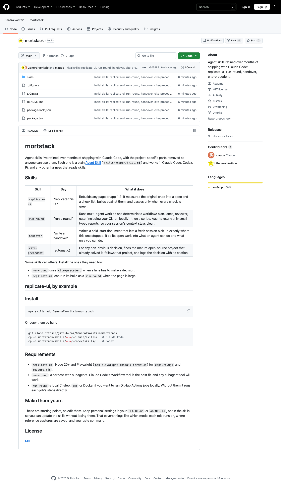
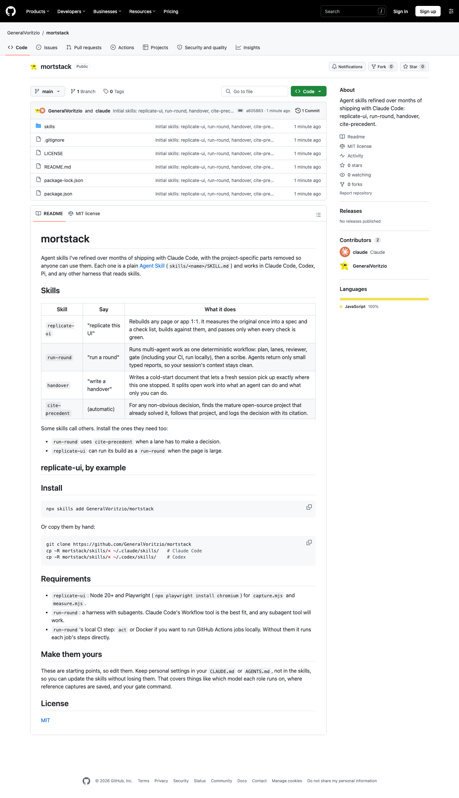

# mortstack

Agent skills I've refined over months of shipping with Claude Code, with the
project-specific parts removed so anyone can use them. Each one is a plain
[Agent Skill](https://agentskills.io) (`skills/<name>/SKILL.md`) and works in
Claude Code, Codex, Pi, and any other harness that reads skills.

## Skills

| Skill | Say | What it does |
|---|---|---|
| `replicate-ui` | "replicate this UI" | Rebuilds any page or app 1:1. It measures the original once into a spec and a check list, builds against them, and passes only when every check is green. |
| `run-round` | "run a round" | Runs multi-agent work as one deterministic workflow: plan, lanes, reviewer, gate (including your CI, run locally), then a scribe. Agents return only small typed reports, so your session's context stays clean. |
| `handover` | "write a handover" | Writes a cold-start document that lets a fresh session pick up exactly where this one stopped. It splits open work into what an agent can do and what only you can do. |
| `cite-precedent` | (automatic) | For any non-obvious decision, finds the mature open-source project that already solved it, follows that project, and logs the decision with its citation. |

Some skills call others. Install the ones they need too:

- `run-round` uses `cite-precedent` when a lane has to make a decision.
- `replicate-ui` can run its build as a `run-round` when the page is large.

## replicate-ui, by example

The page you're reading now, rebuilt by `replicate-ui`. On the left is this
repo's GitHub page as of the first commit. On the right is a static HTML
rebuild of it. Both are captured at 1400px.

| GitHub | Rebuild |
|---|---|
|  |  |

How it went:

1. `capture.mjs` took one pass over the live page and saved the shots, section
   boxes and tokens. Two short probes then measured about 40 elements. That
   was the only time the original was read.
2. The [check list](docs/example/rebuild/checks.json) has 39 measured facts:
   section order, document height, the header, tabs, title bar, file table,
   README box, Markdown type and the sidebar rhythm. One more check is manual.
3. Five build-and-measure loops took the rebuild from 15 checks passing to
   21, 33, 36, then 39. Each loop read a few lines of `measure.mjs` output,
   not a screenshot.

Two rules in the skill came from this run:

- **Measure the font that actually rendered.** GitHub's CSS declares
  "Mona Sans VF", but signed-out visitors get the system font. Copying the
  declared font made every line of text 3% too wide.
- **A measurement must name its frame.** One check was written against a tab's
  icon instead of the tab's box. The runner flagged it, and the fix went into
  the check, not the build.

The rebuild uses no GitHub code or class names. Icons are
[Primer Octicons](https://github.com/primer/octicons) (MIT) and the README body
uses [github-markdown-css](https://github.com/sindresorhus/github-markdown-css)
(MIT). Source: [docs/example/rebuild](docs/example/rebuild).

## Install

```bash
npx skills add GeneralVoritzio/mortstack
```

Or copy them by hand:

```bash
git clone https://github.com/GeneralVoritzio/mortstack
cp -R mortstack/skills/* ~/.claude/skills/   # Claude Code
cp -R mortstack/skills/* ~/.codex/skills/    # Codex
```

## Requirements

- `replicate-ui`: Node 20+ and Playwright (`npx playwright install chromium`) for
  `capture.mjs` and `measure.mjs`.
- `run-round`: a harness with subagents. Claude Code's Workflow tool is the best
  fit, and any subagent tool will work.
- `run-round`'s local CI step: `act` or Docker if you want to run GitHub Actions
  jobs locally. Without them it runs each job's steps directly.

## Make them yours

These are starting points, so edit them. Keep personal settings in your
`CLAUDE.md` or `AGENTS.md`, not in the skills, so you can update the skills
without losing them. That covers things like which model each role runs on,
where reference captures are saved, and your gate command.

## License

[MIT](LICENSE)
